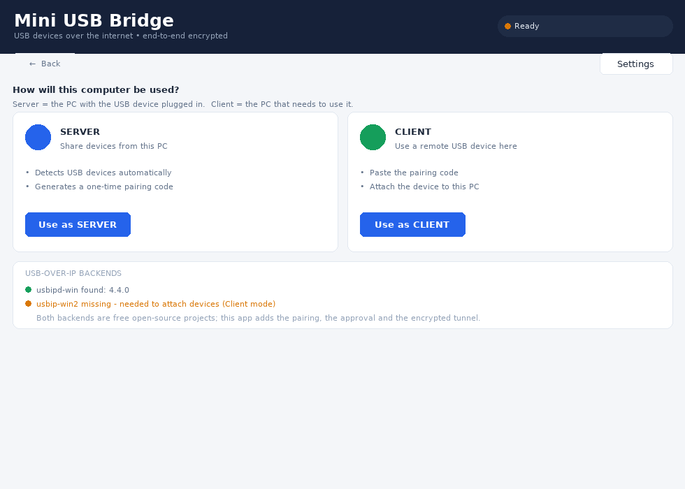
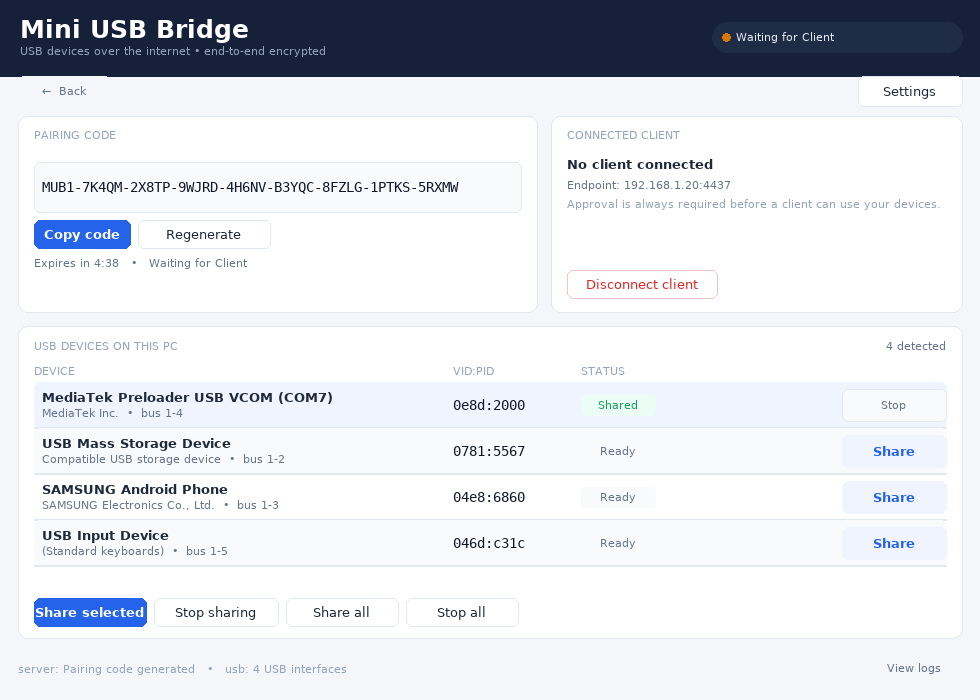
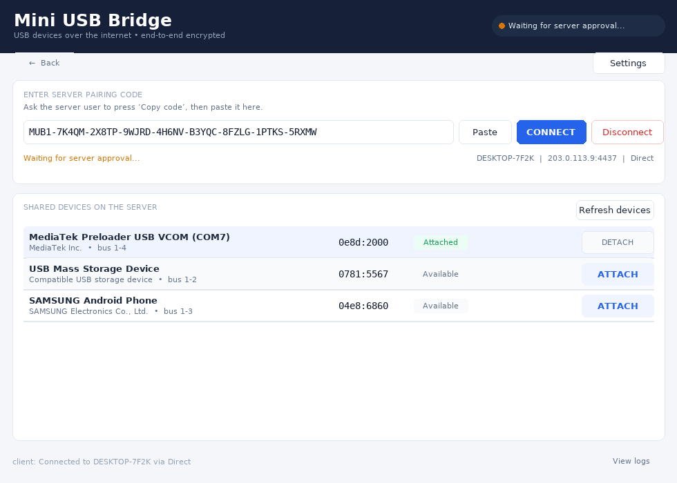
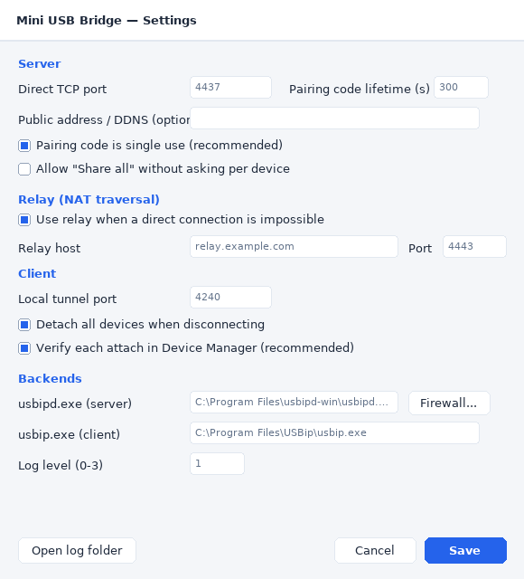
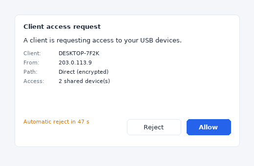

# Mini USB Bridge

Native Windows 10/11 app (C++17, Win32, ~1 MB) that shares the USB devices of one PC with another PC
over the internet, so the remote device shows up in **Device Manager** and works with normal Windows
software (for example SP Flash Tool).

* **SERVER** mode — on the PC where the USB device is plugged in.
* **CLIENT** mode — on the PC that needs the device.

The USB redirection itself is done by two proven USB/IP implementations; this project provides the
GUI, the pairing/approval security, the encrypted tunnel and the reliability handling on top of them.

```
 Server PC                                     Client PC
 ┌───────────────────────┐                    ┌───────────────────────┐
 │ MiniUsbBridge.exe     │  TLS 1.2/1.3       │ MiniUsbBridge.exe     │
 │  usbipd-win (GPL-3)   │  (SChannel)        │  loopback tunnel      │
 │  usbipd service :3240 │◄──────────────────►│  usbip-win2 driver    │
 │        (loopback only)│  pairing + approval│  (UDE virtual host)   │
 └───────────────────────┘  + HMAC + pinning  └───────────────────────┘
```

USB/IP traffic **never leaves the machine unencrypted**: both ends connect to their own
`127.0.0.1:3240`, and the only thing on the wire is our authenticated TLS channel
(direct, or through the included relay when neither side has a reachable port).

### Screens

| Start screen | Server mode |
|---|---|
|  |  |

| Client mode | Settings | Client approval on the server |
|---|---|---|
|  |  |  |

*(Rendered from the same layout math as `src/ui/main_window.cpp` by `tools/preview_ui.py`, so the
geometry and copy match the real owner-drawn Win32 UI.)*

---

## What is implemented and verified

| Area | Status |
|---|---|
| Native Win32 GUI (choose SERVER/CLIENT, server & client screens, settings, approval dialog) | implemented, compiles clean with MSVC-style `/W4` semantics and cross-compiles with MinGW |
| Portable core: SHA-256/HMAC, Crockford pairing codes, protocol framing, pairing decision matrix, USB/IP header inspection | **248 automated checks pass** (`tools/test_core.sh`) |
| Relay: pairing, byte splicing, auth-tag enforcement, duplicate-role refusal | **10 automated protocol checks pass** (`tests/test_relay.py`) |
| TLS 1.2/1.3 with certificate pinning (SChannel), DPAPI-protected server identity | implemented; requires Windows to exercise |
| USB enumeration (SetupAPI), device add/remove, busid/sharing state via `usbipd state` | implemented; requires Windows + usbipd-win |
| USB/IP export/import through `usbipd.exe` / `usbip.exe` | implemented; **needs a real USB device to confirm** |
| Installer (Inno Setup 6, multi-page, backend detection, firewall, uninstall) | script complete; build on Windows with Inno Setup |
| Real hardware validation (two PCs, two networks, MediaTek Preloader/BROM) | **not yet done — see `docs/TESTING.md`** |

> Honest status: nothing in this repository claims that USB redirection has already been tested on
> physical hardware. The code paths that decide "attached successfully" are deliberately strict, and
> `docs/TESTING.md` lists exactly how to prove each acceptance criterion on real machines.

---

## Quick start (two PCs)

1. Install this app on **both** PCs (installer, or `build.ps1` + `dist\app\MiniUsbBridge.exe`).
2. Install the backends (the installer's *USB-over-IP backends* page links to them, and the app shows
   their status on the start screen):
   * **Server PC:** [usbipd-win](https://github.com/dorssel/usbipd-win/releases) — `winget install usbipd`
   * **Client PC:** [usbip-win2](https://github.com/vadimgrn/usbip-win2/releases) — installs the signed
     UDE virtual USB host controller driver (may need one reboot; USB 3.0 hubs restart during setup)
3. On the **Server PC**: `SERVER` → a pairing code appears → copy it.
4. On the **Client PC**: `CLIENT` → paste the code → **CONNECT**.
5. The Server PC shows *"A client is requesting access to your USB devices"* → press **Allow**.
6. On the Server PC press **Share** next to the device you want to expose.
7. On the Client PC press **ATTACH** next to that device. The device appears in Device Manager.

Details, screenshots-in-words and the MediaTek notes: [`docs/QUICKSTART.md`](docs/QUICKSTART.md).

---

## Connectivity (truthful version)

* The pairing code contains the server's address, so **direct connections work** on a LAN, through a
  forwarded port, or over a VPN/tailnet (WireGuard, Tailscale, ZeroTier).
* Two arbitrary NATs cannot be joined without infrastructure. This project therefore ships a small
  **relay** (`relay/relay.cpp`, also runs on Linux) that both sides connect *out* to; the relay only
  splices bytes and cannot read them (TLS stays end-to-end). See [`docs/RELAY.md`](docs/RELAY.md).
* The UI tells you which path is in use: *Direct* or *Relay*. It never pretends a relayed session is
  direct. UDP hole punching / STUN / ICE is **not** implemented.

## Security model (short version)

* 128-bit random pairing secret + random 64-bit session id, encoded as `MUB1-…` (Crockford base32).
* Codes expire (default 300 s), are single-use by default, and are invalidated when regenerated.
* Challenge/response over TLS 1.2/1.3: client proof `HMAC(secret, "MUB1-AUTH"‖sid‖nonceC‖nonceS‖certPin)`,
  server proof `HMAC(secret, "MUB1-OK"‖sid‖nonceC‖nonceS)` — mutual authentication.
* The server certificate is **pinned** to the 10-byte hash carried in the code, so an intercepting proxy
  cannot impersonate the server even if it breaks the OS trust chain.
* The human must press **Allow** (60 s auto-reject). No approval, no session token.
* Data channels re-authenticate with a 32-byte session token; approval requires no new code.
* The relay's session join is authenticated with a key derived from the pairing secret.
* Brute force: 5 failed attempts lock the code; a 128-bit secret cannot be guessed.
* Tokens are never logged (`Logger` redacts `MUB1-…` codes), and the server identity file is encrypted
  with DPAPI.
* Full threat model: [`docs/SECURITY.md`](docs/SECURITY.md).

## MediaTek / Android flashing — read this first

Preloader (`0E8D:2000`) and BROM (`0E8D:0003`) modes appear and disappear in fractions of a second,
each with a *new* Windows device instance. usbipd-win exports a specific device instance, so the export
and the client's virtual device die with every mode transition. USB/IP is not able to keep such a
short-lived device stable across a WAN.

What the app does about it:

* detects the re-enumeration immediately and shows *"Device re-enumerated"* instead of pretending;
* never detaches/unbinds automatically while a device is attached (a running flash is not interrupted
  by our housekeeping);
* never re-attaches automatically — you re-share and re-attach manually after each mode change;
* reports the backend's real error text when an attach fails.

Practical guidance for flashing: use the lowest-latency path you have (same LAN or a VPN), keep the
device list open on both sides, and prefer devices that stay enumerated (ADB/fastboot/VCOM ports). See
[`docs/QUICKSTART.md`](docs/QUICKSTART.md#mediatek--sp-flash-tool-notes).

---

## Build

Requirements: Windows 10/11, CMake ≥ 3.20, Visual Studio 2019/2022 (Desktop C++), Inno Setup 6 (only for
the installer).

```powershell
.\build.ps1                # configure + build + run tests + collect dist\app
.\build.ps1 -Installer     # also produce dist\MiniUsbBridge-1.0.0-setup.exe
```

Manual equivalent:

```powershell
cmake -S . -B build -G "Visual Studio 17 2022" -A x64
cmake --build build --config Release
build\Release\test_core.exe
iscc installer\MiniUsbBridge.iss
```

Portable tests (Linux/macOS, no Windows needed): `./tools/test_core.sh`

## Project layout

```
src/main.cpp               entry point, single-instance, --mode server|client, elevated helper dispatch
src/core/                  portable, unit-tested: sha256/hmac, base32, pairing, protocol, session_auth,
                           usbip_wire (USB/IP header inspection), logger, settings, strings
src/win/                   net (Winsock), tls (SChannel + pinning), crypto (BCrypt), process, elevated
src/net/channel.cpp        framed TLS control channel, byte pump, relay connector
src/server/                usb_detect (SetupAPI), usbipd_cli, server_mode (pairing, approval, tunnel)
src/client/                usbip_cli, client_mode (loopback tunnel, attach verification)
src/ui/                    main_window (owner-drawn Win32), settings_dialog + approval dialog, theme
relay/relay.cpp            self-hostable relay (Windows and Linux)
installer/                 Inno Setup script
tests/                     core unit tests + relay protocol tests
docs/                      QUICKSTART, TROUBLESHOOTING, ARCHITECTURE, SECURITY, RELAY, TESTING
```

## Backends, licenses and what is *not* bundled

* [usbipd-win](https://github.com/dorssel/usbipd-win) — **GPL-3.0**, server side. Started as a separate
  process (`usbipd.exe`); no code is linked into this app.
* [usbip-win2](https://github.com/vadimgrn/usbip-win2) — **BSD-2-Clause**, client side (UDE driver).
* Rejected after inspection: [ren2r/usbip-win](https://github.com/ren2r/usbip-win) (unmaintained since
  2021, no Windows 10 driver story) and [ameggs/OpenUSBIP](https://github.com/ameggs/OpenUSBIP)
  (userland Python, no kernel driver ⇒ the device can never appear in Device Manager).

This application is MIT licensed (see `LICENSE`) and does not redistribute the backend binaries; the
installer links to the official releases and can optionally install copies you place in
`installer/backends/`.

## Limitations you should know

1. A device that is shared through usbipd-win **cannot be used by the server PC itself** while shared.
2. The client needs the usbip-win2 kernel driver (Windows 10 1903+), which is a separate install.
3. A device that resets/re-enumerates always costs a re-attach; there is no transparent failover.
4. Some devices (keyboards/mice, some phones in specific modes) are refused or unstable over USB/IP;
   those are backend properties, not something this app hides.
